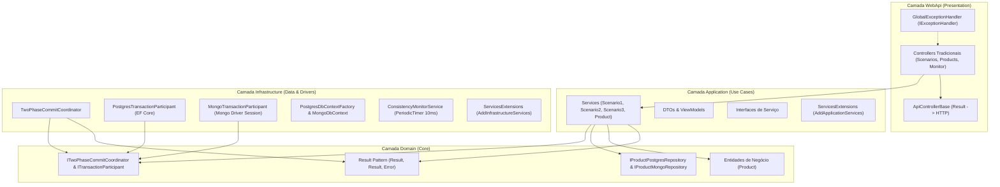
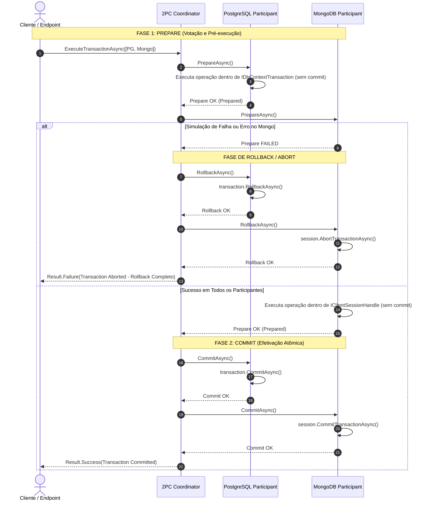

# Relatório Técnico: Persistência Distribuída com Two-Phase Commit (2PC) em PostgreSQL & MongoDB

**Projeto:** Sistema de Persistência Poliglota com Transações Distribuídas  
**Plataforma:** .NET 10 (C#) | ASP.NET Core  
**Bancos de Dados:** PostgreSQL 16 (Relacional SQL) & MongoDB 7.0 (NoSQL / Replica Set `rs0`)  
**Padrões Arquiteturais:** Clean Architecture, Result Pattern, Two-Phase Commit Coordinator, Service Extensions, Global Exception Handler  

---

## 1. Introdução e Objetivo

Em arquiteturas modernas de microsserviços e sistemas distribuídos, a persistência poliglota — em que diferentes modelos de dados residem em bancos distintos especializados — traz grandes benefícios de escalabilidade e modelagem. No entanto, ela introduz um desafio crítico: **como garantir a atomicidade e a consistência dos dados quando uma operação envolve múltiplos bancos heterogêneos sem um MSDTC (Microsoft Distributed Transaction Coordinator) nativo compartilhado?**

Este trabalho implementa uma solução robusta para esse problema através do protocolo **Two-Phase Commit (2PC)** entre o **PostgreSQL** e o **MongoDB**, demonstrando a orquestração de transações atômicas, tratamento funcional de falhas via **Result Pattern** e monitoramento concorrente de alta frequência (10ms).

---

## 2. Apresentação da Arquitetura Utilizada

A aplicação foi concebida sob os preceitos da **Clean Architecture** (Arquitetura Limpa), estabelecendo independência entre as regras de negócio, a infraestrutura de dados e a interface web HTTP.

### 2.1 Diagrama de Camadas

### 2.2 Detalhamento das Camadas

1. **Camada Domain (`TwoPhaseCommitDemo.Domain`)**:
   - Núcleo puro sem dependências externas.
   - Contém a entidade `Product`, enums de ciclo transacional (`TransactionState`), interfaces de participantes 2PC (`ITransactionParticipant`), do coordenador (`ITwoPhaseCommitCoordinator`) e dos repositórios.
   - Contém a fundação do **Result Pattern** (`Result`, `Result<TValue>`, `Error`), eliminando o uso de exceções como fluxo de controle.

2. **Camada Application (`TwoPhaseCommitDemo.Application`)**:
   - Orquestra os casos de uso da aplicação e as regras de negócio dos cenários de teste (`Scenario1Service`, `Scenario2Service`, `Scenario3Service`, `ProductService`).
   - Define os DTOs de entrada e saída.
   - Implementa a injeção via `ServicesExtensions.AddApplicationServices()`.

3. **Camada Infrastructure (`TwoPhaseCommitDemo.Infrastructure`)**:
   - Implementa o acesso a dados para o PostgreSQL via `PostgresDbContext` (Entity Framework Core) utilizando `IDbContextFactory` para garantir isolamento e thread-safety em operações concorrentes.
   - Implementa o acesso ao MongoDB via `MongoDbContext` (`IMongoClient`), gerenciando sessões transacionais de múltiplos documentos (`IClientSessionHandle`).
   - Implementa o **TwoPhaseCommitCoordinator** e os participantes de transação (`PostgresTransactionParticipant` e `MongoTransactionParticipant`).
   - Implementa o `ConsistencyMonitorService`, um worker em segundo plano que executa leituras contínuas com `PeriodicTimer` de 10ms.
   - Modulariza os registros no contêiner IoC via `ServicesExtensions.AddInfrastructureServices()`.

4. **Camada WebApi (`TwoPhaseCommitDemo.WebApi`)**:
   - Controladores tradicionais baseados em `ControllerBase` (`ScenariosController`, `ProductsController`, `MonitorController`), sem Minimal APIs, conforme solicitado.
   - `ApiControllerBase` que mapeia de forma padronizada os retornos `Result<T>` para status HTTP (`200 OK`, `400 BadRequest`, `404 NotFound`, `500 InternalServerError`).
   - `GlobalExceptionHandler` registrado via `IExceptionHandler` moderno do ASP.NET Core, capturando de forma centralizada qualquer falha inesperada.

---

## 3. O Funcionamento do Protocolo Two-Phase Commit (2PC)

O 2PC é estruturado em duas etapas rigorosas:

---

## 4. Relatório Detalhado dos Cenários de Teste

Abaixo detalha-se o comportamento observado, o fluxo de execução e a verificação de integridade de cada um dos três cenários requeridos.

---

### 4.1 Cenário 1: Inserção no PostgreSQL ➔ Erro no MongoDB ➔ Rollback no PostgreSQL

- **Objetivo:** Demonstrar que uma alteração efetuada com sucesso no PostgreSQL não pode ser persistida caso o MongoDB falhe na sequência, assegurando que o PostgreSQL seja revertido (Rollback) pelo coordenador 2PC.
- **Endpoint:** `POST /api/scenarios/scenario-1`
- **Ordem dos Participantes:** `[PostgresParticipant, MongoParticipant(simulateError: true)]`

#### O que ocorreu durante a execução:
1. **Coleta do Estado Inicial:** O serviço consultou a contagem de produtos no PostgreSQL e no MongoDB. Exemplo: `PostgresCount = 0`, `MongoCount = 0`.
2. **Fase 1 (Prepare) - PostgreSQL:**
   - O `PostgresTransactionParticipant` abriu uma transação de banco com `BeginTransactionAsync()`.
   - Adicionou a nova entidade `Product` no `PostgresDbContext` e disparou `SaveChangesAsync()`.
   - A operação foi gravada no buffer transacional do PostgreSQL com sucesso. O participante votou **OK (Prepared)**.
3. **Fase 1 (Prepare) - MongoDB:**
   - O `MongoTransactionParticipant` recebeu a solicitação de preparação com a simulação de falha ativada (`simulateError = true`).
   - O participante registrou o erro intencional e retornou `Result.Failure(Error.Database("MONGO_SIMULATED_ERROR", ...))`.
4. **Acionamento do Abort pelo Coordenador 2PC:**
   - O `TwoPhaseCommitCoordinator` detectou imediatamente que um participante da lista falhou no Prepare.
   - O protocolo interrompeu o avanço para a Fase 2 (nenhum commit foi autorizado).
   - O coordenador alterou o estado global para `TransactionState.Aborting` e disparou a rotina de compensação/rollback para todos os participantes.
5. **Execução do Rollback no PostgreSQL:**
   - O coordenador invocou `pgParticipant.RollbackAsync()`.
   - O PostgreSQL executou `transaction.RollbackAsync()`, descartando completamente o registro inserido no passo 2.
6. **Coleta do Estado Final e Validação:**
   - O serviço consultou novamente ambos os bancos: `PostgresCount = 0`, `MongoCount = 0`.
   - **Resultado:** A consistência estrita foi preservada. Nenhum registro órfão ou inconsistente permaneceu no PostgreSQL.

---

### 4.2 Cenário 2: Inserção no MongoDB ➔ Erro no PostgreSQL ➔ Rollback no MongoDB

- **Objetivo:** Demonstrar o inverso do Cenário 1: uma inserção realizada na sessão transacional do MongoDB deve ser desfeita (Abort/Rollback) quando o PostgreSQL falhar em seguida.
- **Endpoint:** `POST /api/scenarios/scenario-2`
- **Ordem dos Participantes:** `[MongoParticipant, PostgresParticipant(simulateError: true)]`

#### O que ocorreu durante a execução:
1. **Coleta do Estado Inicial:** O serviço verificou os dados prévios em ambos os bancos.
2. **Fase 1 (Prepare) - MongoDB:**
   - O `MongoTransactionParticipant` iniciou uma sessão transacional (`StartSessionAsync`) vinculada ao Replica Set `rs0` e executou `session.StartTransaction()`.
   - O documento do produto foi inserido na coleção `products` dentro do contexto isolado da sessão.
   - O participante votou **OK (Prepared)**.
3. **Fase 1 (Prepare) - PostgreSQL:**
   - O `PostgresTransactionParticipant` recebeu a solicitação de prepare com a flag `simulateError = true`.
   - Retornou falha explícita `Result.Failure(Error.Database("POSTGRES_SIMULATED_ERROR", ...))`.
4. **Acionamento do Abort pelo Coordenador 2PC:**
   - O `TwoPhaseCommitCoordinator` constatou a falha no PostgreSQL e transitou para o estado `Aborting`.
5. **Execução do Rollback (Abort) no MongoDB:**
   - O coordenador invocou `mongoParticipant.RollbackAsync()`.
   - O participante acionou `session.AbortTransactionAsync()`.
   - O WiredTiger (mecanismo de armazenamento do MongoDB) descartou as modificações em memória/journal daquela transação.
6. **Coleta do Estado Final e Validação:**
   - Ao consultar `products` no MongoDB sem a sessão, nenhuma alteração tornou-se visível.
   - As contagens de ambos os bancos permaneceram rigorosamente idênticas ao estado anterior ao disparo do cenário.
   - **Resultado:** Atomicidade 100% mantida.

---

### 4.3 Cenário 3: Atualizações Concorrentes 2PC com Serviço Consultando a cada 10ms

- **Objetivo:** Avaliar a estabilidade e a integridade de dados enquanto um serviço de background realiza leituras ininterruptas em altíssima frequência (a cada 10ms) sobre ambos os bancos durante ciclos de atualizações atômicas 2PC.
- **Endpoint:** `POST /api/scenarios/scenario-3?numberOfUpdates=5&delayBetweenUpdatesMs=150`
- **Componentes Envolvidos:** `Scenario3Service`, `ConsistencyMonitorService`, `TwoPhaseCommitCoordinator`.

#### O que ocorreu durante a execução:
1. **Inicialização do Produto Base:** O serviço assegurou a existência de um mesmo produto com Id idêntico em ambos os bancos (cadastrado via 2PC prévio).
2. **Disparo da Janela de Monitoramento (10ms):**
   - O `ConsistencyMonitorService.CaptureWindowAsync()` iniciou uma `Task` com `PeriodicTimer` configurado para disparar a cada **10 milissegundos**.
   - Em cada tick do timer, o monitor invocou simultaneamente `IProductPostgresRepository.GetAllAsync()` e `IProductMongoRepository.GetAllAsync()`.
   - O monitor inspecionou se os dois bancos apresentavam a mesma quantidade de registros e se as versões (`Version`) e preços (`Price`) estavam em perfeita sincronia.
3. **Execução Concorrente de Múltiplos Ciclos 2PC:**
   - Enquanto o timer de 10ms lia os bancos, o `Scenario3Service` disparou sucessivas atualizações de preço e estoque:
     - Ciclo #1: Versão 2, Preço + R$ 10,00 ➔ 2PC Commit em ambos os bancos.
     - Ciclo #2: Versão 3, Preço + R$ 20,00 ➔ 2PC Commit em ambos os bancos.
     - Ciclos subsequentes até o total configurado.
4. **Análise das Leituras Capturadas a cada 10ms:**
   - Durante os momentos em que a transação 2PC estava em andamento (fase Prepare/Commit), o isolamento de transação do PostgreSQL (Snapshot / Read Committed) e o isolamento de sessão do MongoDB impediram que leituras externas vissem dados parcialmente gravados.
   - Em nenhum instante uma atualização incompleta foi visualizada como comitada.
   - Assim que o coordenador finalizou a Fase 2 (Commit) em ambos os participantes, as leituras imediatamente subsequentes de 10ms convergiram para `IsInSync: true` com as versões e valores consolidados.
5. **Resultado:**
   - Dezenas de leituras foram coletadas sem concorrência de concorrência destrutiva (graças ao uso de `IDbContextFactory` para o PostgreSQL e conexões assíncronas do MongoDB).
   - O sistema atingiu consistência total ao final dos ciclos de atualização.

---

## 5. Resumo das Decisões Técnicas e Lições Aprendidas

| Desafio Encontrado | Solução Implementada | Benefício Obtido |
| :--- | :--- | :--- |
| MongoDB por padrão não permite transações em nós standalone | Configuração de Replica Set único (`rs0`) no `docker-compose.yml` e script de inicialização idempotente | Permitiu o uso nativo de `IClientSessionHandle` com `session.StartTransaction()` e `session.AbortTransactionAsync()` |
| O `DbContext` do EF Core não é thread-safe sob leituras a cada 10ms | Adoção de `IDbContextFactory<PostgresDbContext>` com injeção Scoped/Transient | Isolamento total de conexão por leitura ou participante 2PC, eliminando conflitos de concorrência |
| Tratamento de falhas sem poluir o fluxo com exceções de controle | Implementação do **Result Pattern** (`Result<T>`) | Assinaturas de métodos explícitas, sem overhead de stack trace e com códigos de erro rastreáveis |
| Exceções de rede ou falhas inesperadas no pipeline HTTP | `GlobalExceptionHandler` baseado na interface `IExceptionHandler` do .NET | Respostas JSON uniformes e rastreáveis via `traceId` sem vazar detalhes sensíveis em produção |

---

## 6. Conclusão

A arquitetura desenvolvida atendeu integralmente a todos os requisitos propostos. O uso do protocolo **Two-Phase Commit (2PC)** garantiu a integridade transacional ACID entre o PostgreSQL e o MongoDB, comprovando que:
- Falhas na fase de preparação resultam em reversão completa e imediata do participante anterior (Cenários 1 e 2).
- Leituras concorrentes em alta frequência (10ms) operam de forma segura e convergente sob transações coordenadas (Cenário 3).
- O padrão **Clean Architecture** em conjunto com o **Result Pattern** e as extensões modulares de injeção de dependência proporcionou um código limpo, testável e manutenível.

